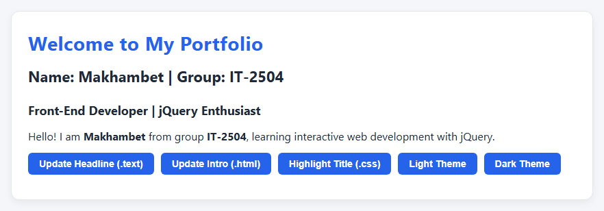
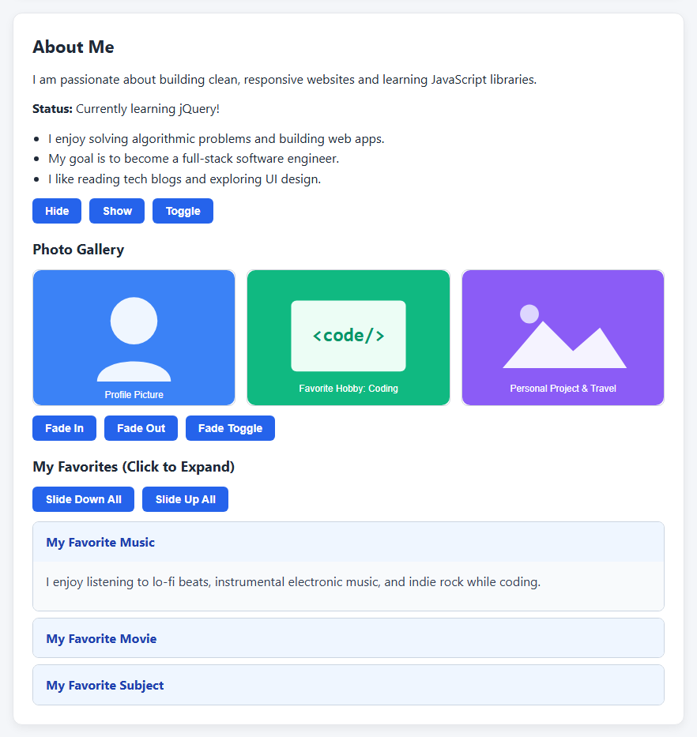
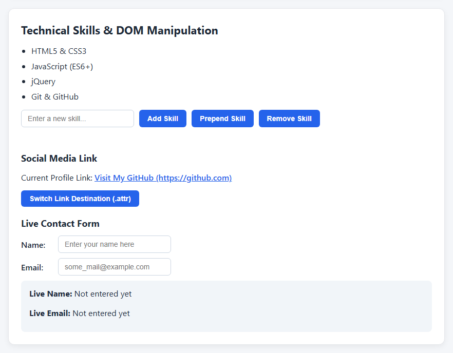
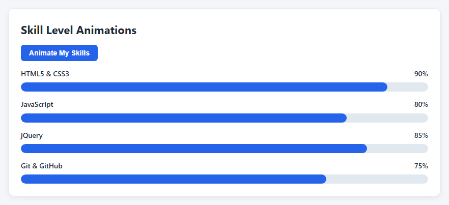

# Assignment #6 - jQuery (Selectors, Effects, Animations)

**Name:** Aidynuly Makhambet
**Group:** IT-2504

## Part 1: Getting Started with jQuery (Setup, Selectors & CSS)

Included jQuery from a CDN and verified the setup with `$(document).ready()` in the console. Used tag, ID, and class selectors along with `.text()`, `.html()`, and `.css()` to dynamically update the portfolio text and switch between light and dark themes.

## Part 2: jQuery Effects (Visibility, Fade & Slide Methods)

Added an "About Me" section controlled by `.hide()`, `.show()`, and `.toggle()` buttons. Created an image gallery using `.fadeIn()`, `.fadeOut()`, and `.fadeToggle()`, as well as collapsible panels using `.slideUp()`, `.slideDown()`, and `.slideToggle()`.

## Part 3: DOM Manipulation with jQuery

Implemented a dynamic skills list using `.append()`, `.prepend()`, and `.remove()` with validation against empty inputs. Added a button that switches the social media link destination using `.attr()`, and built a contact form that shows live user input via `.val()` and `.text()`.

## Part 4: Animations

Created visual skill bars that start at zero width and smoothly expand to different target percentages (`90%`, `80%`, `85%`, and `75%`) using `.animate()` when the button is clicked, and animate back to zero width on the next click.

## Summary
During this assignment, I learned how to include jQuery from a CDN, select DOM elements, and dynamically modify text, HTML, styles, and attributes. I also practiced applying visibility, fade, and slide effects as well as creating smooth custom width animations with `.animate()`.

